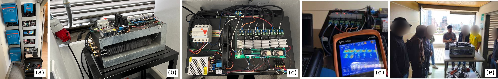

# SolarIoT Load Bank

Open-architecture, 6 kW, three-phase variable resistive load built as a
measurement instrument for a 6.9 kWp battery-buffered PV teaching microgrid
at Universidad de los Andes (Bogotá, Colombia).

In a battery-buffered plant the charge controller curtails the array when the
battery is nearly full, so PV output stops following irradiance during the
sunniest hours. This load bank absorbs the surplus on command and returns the
plant to resource-limited operation, which makes it observable again for
teaching and research.

This repository accompanies the paper:

> D. A. Cañón Borbón, J. D. Ontibón Velásquez, A. L. González Mancera,
> G. A. Jiménez Estévez, and J. J. Vásquez Polanía, "A 6 kW Open-Architecture
> Three-Phase Variable Resistive Load for Restoring Plant Observability in
> Battery-Buffered PV Teaching Microgrids," IEEE Southern Power Electronics
> Conference (SPEC), Cartagena, Colombia, 2026.



## What is in the repository

| Folder | Content |
|---|---|
| `firmware/SolarIoT_Slave/` | Slave ESP32: zero-cross-locked timebase, TRIAC firing (phase angle with linearization table, or integral-cycle control), hard protections |
| `firmware/SolarIoT_WebMaster/` | Master ESP32: web page, REST API, MQTT/TLS, sensors, mode arbitration, supervisory lease, power cap, thermal derating, fan interlock |
| `firmware/SolarIoT_Estudiantes_Taller/` | Example student client used in the undergraduate workshop |
| `hardware/` | Simplified power-stage schematic and control hierarchy (PDF and circuitikz source), photos |
| `mechanical/` | Enclosure CAD model (STEP), fabrication drawing, forced-convection thermal design script, and the design report |
| `docs/BOM.md` | Bill of materials and cost estimate |

## System overview

- **Load:** six 1 kW finned U-type resistors at 120 V, two per phase, wye with neutral.
- **Switches:** one BTA312B TRIAC per resistor, one optocoupled zero-cross detector per phase.
- **Host bus:** three single-phase inverter/chargers sharing a 48 V LiFePO4 bus and forming an islanded 120/208 V, 60 Hz bus. The firing timebase therefore tracks the zero crossings continuously instead of assuming a fixed frequency.
- **Control levels:**
  - *Primary (firing), slave ESP32:* turns each set-point into gate pulses, once per cycle (integral-cycle mode, default, zero DC by construction) or per half-cycle (phase-angle mode).
  - *Coordination, master ESP32:* classroom vs. automatic mode, supervisory lease every 0.5 s, power cap (80 % by default), thermal derating, fan relay.
  - *Supervisory:* an external SCADA (or student clients over MQTT) sets the load.
- **Protections (in the slave, so they survive a master or network failure):**
  - *Revocation* clears the set-points and requires a new command: latched thermal trip, or loss of the supervisory lease for 30 s.
  - *Inhibition* keeps the set-point and forces zero output while the condition lasts: dead phase reference, silent master, invalid temperature, fans not confirmed.
- The fan relay is wired normally closed: the fans run whenever the controller is unpowered or resetting. The resistor rating assumes forced airflow, so the fan interlock is part of the thermal protection.

Firmware version in this repository: **v3.4** (`FW_VERSION=3.4`, build
`2026-10-23-review3` plus patches `[M34]`, `[C22]`, `[C23]`, `[C24]`). Code
comments are in Spanish and every change carries a tag (`[Cxx]` for the slave,
`[Mxx]` for the master) explained at the top of each `main.cpp`.

## Building

Each folder under `firmware/` is an independent PlatformIO project
(`esp32dev`, Arduino-ESP32 2.0.17).

```bash
cd firmware/SolarIoT_WebMaster
cp src/secrets.h.example src/secrets.h   # fill in your own values; secrets.h is git-ignored
pio run
cd ../SolarIoT_Slave
pio run
```

The master and the slave share a 32-byte I2C status frame and must always be
flashed together. The master needs a valid clock (NTP) before it opens the
MQTT/TLS connection, and `MQTT_CA_CERT` must hold the CA that signed your
broker certificate. If `API_TOKEN` is left at its example value the firmware
warns at boot and publishes `token_default: true`.

## Safety

This equipment switches 6 kW at mains voltage. Work on it de-energized, keep
the power cap low while testing, and do not run it without confirmed airflow.
The authors provide the design for teaching and research and accept no
liability for its use.

## License

Released under the MIT License (see `LICENSE`). The mechanical design in
`mechanical/` was developed by Juan José Vásquez Polanía.
